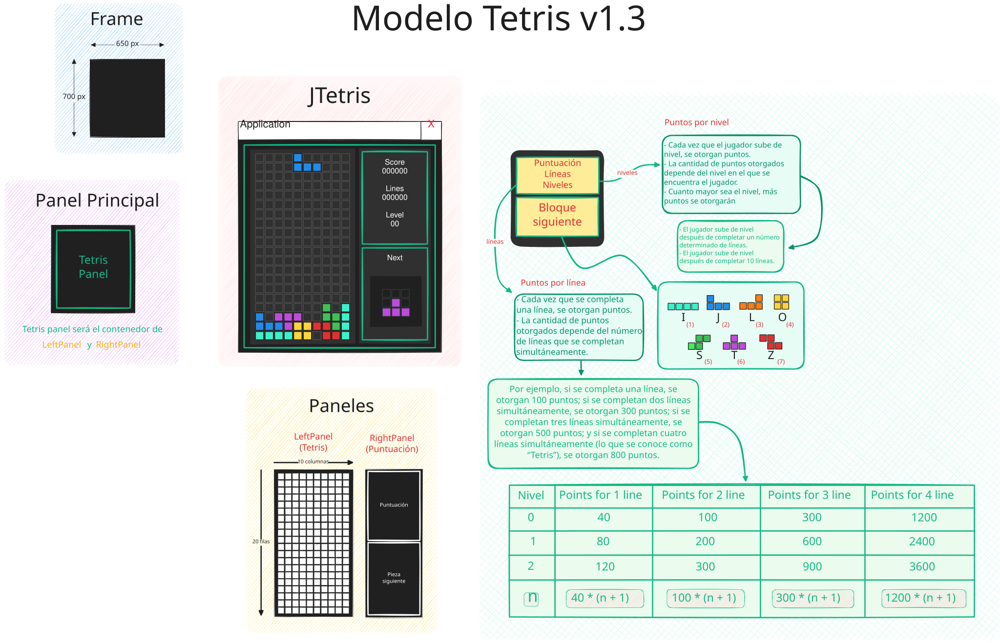

# The Game
We are coding this Tetris clone in Java for the willing of learning and practice the language, aswell as having fun building it.

# Challenge
Code the entire game only using native Java components such as `javax.swing` or `java.awt`. We want to build this using non-generated code from tools like **NetBeans** Interface Design features, we really want to build it *'by hand'*.

# Our tiny team
We are software engineering students who don't know much, but what we know is that we are coding this up!
We really hope the best LMAO. Hope this proyect turns a completely success. Cheers! 🍷

---

# 2026-10-01 - Game completed (AI-generated slop)

> **Transparency notice:** Everything below was written and programmed by an AI. The project had been abandoned
> since 2021, with the game still unplayable. Someone eventually finished it in one go just to make it playable.
> Most of the code currently in `src/` is **AI-generated slop**, not the original team's work.
> It works as a playable game and serves as a foundation for further development, but it should not be mistaken
> for the original authors' work.

## Why the project was abandoned

In the state it was left in, the game compiled but **could not actually be played**: the menu would open, you could press PLAY, and the screen would remain stuck on an empty, unusable board. The specific reasons were:

- **The game loop could never terminate.** Its condition was `while (gameThread != null)`, but `gameThread` was never set to `null`. The thread would enter an infinite loop, consuming an entire CPU core.
- **Rotation was broken.** Counterclockwise rotation copied entire rows instead of transposing the matrix, and `rotatedShape` was calculated but never assigned back to `actualShape`. In other words, rotating did nothing. The SRS tables were already documented but nobody was actually using them.
- **Tetrominoes were missing.** There was no mechanism to generate pieces, so the board had nothing to draw.
- **Controls were empty.** `moveToTheLeft()`, `moveToTheRight()`, `clearRow()`, `insertTetromino()` and `update()` were all empty methods. There wasn't even a single `KeyListener`.
- **Two matrices were occasionally left out of sync.** `fieldArray` and `checkArray` were never fully synchronized, and `endLine` was never cleared.
- **The score panel was just decoration.** It drew two boxes and nothing else: no score, no lines, and no level information.

## What was added and fixed

### Fixes to existing code

- **Proper rotation:** Counterclockwise matrix transposition was fixed, and rotations are now applied only after the board confirms they are valid. If the piece cannot rotate in its current position, the SRS tests are attempted in order. If none of them succeeds, the piece remains unchanged without corrupting its internal state (`applyRotation` / `cancelRotation`).
- **A `typeId` for each tetromino:** The color used to be a shared `static` field, meaning every piece inherited the color of the last one created. Each tetromino now has its own identifier and color.
- **A game loop that can terminate without burning CPU:** The `while` loop now checks an interruptible flag, and the game thread waits for the remaining time between frames instead of recalculating everything at full speed. The `System.out.println` statements that printed "FPS: ..." every second were also removed.
- **`GamePanel` no longer paints everything twice:** `paintComponent` used to draw its child components and then manually paint them all over again.
- **`MenuButton`:** The text was positioned using coordinates that the button itself assigned during border painting, which caused the text to appear misaligned. The button now uses its actual dimensions.
- **`MainMenuPanel`:** Buttons were being positioned inside `paintComponent`, which meant child components were drawn using their positions from the previous frame. They are now positioned once in the constructor.
- **Proper panel sizing:** `GridPanel` (380 px) and `ScorePanel` (300 px) did not fit within the 650 px window, causing the panels to overlap and the right one to be cut off. Their dimensions now add up correctly, and the window uses `pack()`.
- **The icon no longer crashes the application:** Calling `ImageIO.read` on a nonexistent file caused a `RuntimeException`. The application now prints a warning to the console and continues using the default icon.
- **Hidden board rows:** Board rendering started at row 4 but used `cells[i - 3]` for indexing, leaving one row undrawn and shifting the remaining rows. The indexing was corrected, and the frame now encloses exactly the visible portion of the board.

### New features

- **`TetrominoFactory`** (`src/Components/Tetros/TetrominoFactory.java`): A piece generator implementing the **7-bag randomizer** from the Tetris Guidelines. It shuffles all 7 pieces and deals them all out before shuffling again, preventing the same piece from appearing five times in a row.
- **Complete game board:** Collision detection, left/right movement, *soft drop*, *hard drop*, gravity with level-based speed progression (using the Guidelines formula), a 500 ms *lock delay* that allows players to move a piece after it touches the ground, completed row detection and clearing, scoring (100/300/500/800 × level, plus 1 point per *soft drop* cell and 2 points per *hard drop* cell), level progression every 10 lines, and game-over detection.
- **Wall kicks and rotation near the ceiling** using the SRS tests that were already documented in the original code. Tests are evaluated in order, and the first valid position is used.
- **Complete keyboard controls:** Arrow keys to move, Down to drop, Space to hard drop, Up or `X` to rotate clockwise, `Z` to rotate counterclockwise, `P` or `Esc` to pause, and `R` to restart.
- **Key-hold movement** (DAS/ARR), allowing players to move a piece quickly towards the edge and then position it precisely in the desired column.
- **Proper thread separation:** Keyboard input is received on Swing's Event Dispatch Thread (EDT), queued, and then processed by the game thread during its update cycle. The board state is protected by a lock to prevent Swing from rendering a partially updated matrix.
- **Ghost piece:** Displays where the current piece would land if dropped immediately.
- **Score, lines, and level** displayed on screen, along with a **next-piece preview**.
- **Fully functional options screen:** Players can choose their starting level (from 1 to 20, which actually affects gameplay) and view the keyboard controls. Previously, this was an empty panel with no way to return to the main menu.
- **Pause and game-over notifications**, along with the ability to restart using `R`.

## How it was tested

Since the project has no testing framework, a separate test suite was written outside `src/`. It runs the game logic without a graphical interface and renders each screen to an in-memory PNG for visual inspection.

The following tests were performed:

- Rotating each of the 7 pieces four times returns it to its exact original shape.
- Rotating clockwise is equivalent to rotating counterclockwise three times.
- Every group of 7 generated pieces contains all 7 distinct tetrominoes.
- The SRS table handles valid indices and does not overflow when given unusual values.
- `clearRow()` removes completed rows, leaves incomplete rows in their original positions, and shifts everything above them down.
- A full 4-line Tetris playthrough correctly awards 4 lines and 800 points.
- Gravity automatically drops the piece, and stacking pieces without clearing any rows eventually ends the game.
- During long random gameplay sessions, no blocks leave the board and the game always reaches a valid game-over state.
- All three panels (main menu, options, and gameplay) render without exceptions.

All three screens were also visually inspected, revealing and allowing the correction of three issues that were only noticeable through visual review: the board frame extended beyond the window, the help text was cut off, and the ghost piece was invisible because the cell's gray border was drawn directly over it.

## How to play

With JDK 21, run the following commands from the project root:

```bash
javac -encoding UTF-8 -d out/classes $(find src -name "*.java")
java -cp out/classes GUI.UI
```

The icon is loaded from `icon/jtetris-icon.png`, so the application must be launched from the repository root.
